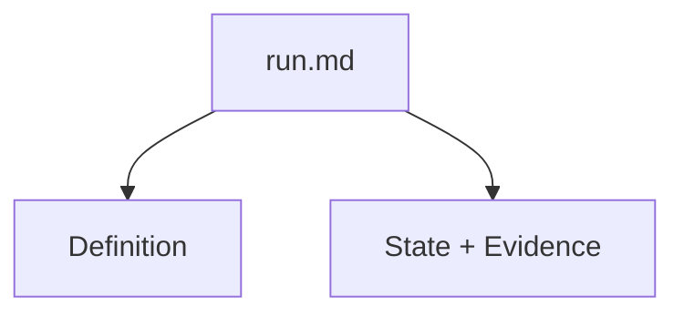

<div align="center">


### The rail a coding agent runs on. Steering, not horsepower.

[](LICENSE)
[](./hermes_plugin/riel/plugin.yaml)
[](https://www.python.org)
[](https://www.nousresearch.com)

</div>

---

## What Riel is

Riel is a **steering layer for coding agents**. It gives a long task three things an
agent does not have on its own: a written contract, persistent execution state, and
verification that comes from running commands instead of from confidence.

The name is Spanish for *rail*. A rail does not make the train faster — it makes the
train go where the track says, and it makes a derailment visible. That is the whole
idea. Riel adds no intelligence to the model. It adds a track, and it checks the wheels.

Everything lives in one directory inside your repository:

```
.riel/
  project.md            optional — the order of the questions
  shapings/<slug>.md    one question each, with its evidence
  runs/<slug>.md        one contract per track, executed IN PLACE —
                        live and finished alike, never pruned
```

`.riel/` is gitignored. It is working state, not source.

## The problem it solves

An agent working on a multi-step task fails in four predictable ways:

| Failure | What it looks like | What Riel does |
|---|---|---|
| **Self-declared completion** | "Done, tests pass" — no test was run | A claim closes only against evidence the engine produced by executing a command and recording its real exit code |
| **Amnesia across sessions** | The next session re-derives the plan from chat history | State lives in a file. `status` computes the cursor, the next step and `done` from evidence |
| **Scope drift** | The fix grows into a refactor nobody asked for | `DO NOT` is written before execution and travels with every delegated slice |
| **Research that evaporates** | The reasoning behind a decision is lost, so it gets re-litigated | A shaping records the question, the sourced findings, what was rejected and why |

Riel is for work that spans sessions, needs proof, or gets delegated. A one-step edit
needs none of it.

## The model: three artifacts

Riel separates **asking**, **committing** and **ordering**. Each has its own file, its
own format and its own job. Mixing them is what makes agent plans unreadable.

### 1. Shaping — one question, answered

`.riel/shapings/<slug>.md` · format `riel-shaping/v3`

A shaping answers **exactly one question** with evidence. Not a task list, not a design
doc: a question, its answer, and what supports the answer.

**Why one question?** Because one question is the unit that fits a single pull request.
Two questions in one file means two tracks tangled in one diff, and no way to tell which
evidence belongs to which decision. The validator enforces it: `## Question` must be one
line with one `?`. Two questions are two shapings.

**Why a separate file from the contract?** Research and commitment change at different
rates. You revise your understanding of a problem many times; you freeze a promise once.
Keeping them apart lets a shaping evolve without silently rewriting what was promised.

### 2. Run — one contract, executed

`.riel/runs/<slug>.md` · format `riel-run/v1`

A run executes **exactly one shaping** and delivers one PR. It is authored in
`.riel/runs/` and **executed in place** — no live copy, no archive move. Several
contracts may be active at once in one worktree, so parallel tracks need no
separate worktrees. The file holds three parts with different owners:

- **Definition** — authored by you, frozen and hashed at activation.
- **State** — written only by the engine.
- **Evidence** — append-only, written only by the engine.

**Why one file?** Because a plan in one file and a ledger in another drift apart. The
cut is `## Metadata`: everything above it is the promise, everything below it is the
record. One file, one hash, one revision.

**Why a selector instead of one live file?** Encoding "which run is active" as a
location forces a move when the work finishes, and makes parallel tracks impossible
without separate worktrees. A contract's state is already derivable from its evidence,
so the location carries no information. With several active contracts a verb refuses
and names them rather than guessing which one it is writing.

### 3. Project — the order of the questions

`.riel/project.md` · format `riel-project/v1` · optional

A project orders several shapings. It is **not** another execution engine: it has no
gates and writes no state. `project status` derives each node's progress from the
contract bound to that shaping.

**Why derive instead of record?** Because a recorded "done" is a claim, and a derived
"done" is a fact. Delete a contract and its node reopens — the project cannot lie
about work whose proof is gone.

## Install

```bash
hermes plugins install "git@github.com:alvarolizama/riel.git#hermes_plugin/riel" --enable
hermes plugins update riel         # after a new version
hermes plugins doctor riel         # verify the installation
```

Enable the desktop integration in **Capabilities → Plugins → riel**, then start a new
session. The installer copies a commit: uncommitted local changes do not travel through it.

**Requirements:** Python 3 and Hermes. No third-party packages — the engine is stdlib
only. There is no CLI on `PATH`: Riel's surface is seven typed tools.

For a local checkout:

```bash
hermes plugins install "file://$(pwd)#hermes_plugin/riel" --enable
```

## Use

The full cycle, with the real calls. Every `new` verb **renders a skeleton to stdout and
writes nothing** — Riel explains formats and validates them but never authors them.

### Who writes what

| step | who |
|---|---|
| `new` → the skeleton | **the tool** — renders to stdout, writes no file |
| saving the file under `.riel/` | **the agent, you in an editor, or your project system** (MCP, API, copy-paste) |
| filling the sections | whoever authors — from the shaping's evidence and the owner's decisions |
| `validate` · `activate` | **the tool** — refuses or accepts, then freezes and hashes |
| State and Evidence below `## Metadata` | **the engine alone**, through `riel_note` |

The uid is minted at RENDER time (`shape new` puts it in the marker); an external
system may supply its own with `params=["id=shp_…"]`. That is what makes the format
usable from a project manager that has never heard of Riel.

### Shape the question

```python
riel_shape(verb="new", params=["name=storage"])
# save the draft at .riel/shapings/storage.md, then fill it
riel_shape(verb="validate", file=".riel/shapings/storage.md")
```

### Order the questions (when there are several)

```python
riel_project(verb="new")
# save at .riel/project.md and list the shapings
riel_project(verb="validate")
riel_project(verb="status")     # names the next shaping to run
```

### Write and activate the contract

```python
riel_run(verb="new", template="run")
# save at .riel/runs/<slug>.md, fill it, declare its shaping under ### Shaping
riel_run(verb="validate")
riel_run(verb="activate")
```

Activation validates the Definition and the bound shaping, resolves every `shaping:F#`
anchor, copies the cited findings into a frozen `### Basis`, and records the shaping's
path, uid and sha256. After this the contract is self-contained.

### Execute and verify

```python
riel_note(
    gates=["G1"],
    claims=["P1"],
    command="make test",
    covering="the parser and its neighbouring regressions",
)
```

The engine **runs** that command in the worktree and records the actual exit code as
`E#` evidence. You never pass an exit code — the schema does not accept one. A checkpoint
for another claim or gate cannot advance this work.

### Read the result

```python
riel_run(verb="status", run="storage")   # one JSON object: cursor, claims, gates, done
riel_run(verb="list")                    # every contract in .riel/runs/, with its state
```

The contract stays where you authored it — there is no archive step and no live
copy. Contracts are never pruned: they are the project's proof. Several tracks may
be active at once; `run=<slug>` picks one, and with a single match it is optional.
To delegate a phase:

```python
riel_run(verb="slice", phase="F1")
```

The child receives an immutable packet — the global sections plus that one phase block
verbatim, with the frozen Basis. No other phase travels. The parent integrates the code
and re-runs the gate before accepting evidence.

## Talking to the agent

You do not call these tools by hand — you talk to the agent in a Hermes chat and it
drives them. What follows is what you say and what actually happens.

One thing to expect: **the agent asks you the decisions it cannot make.** Which command
proves a claim, where the scope boundary sits, which tradeoff wins — those are yours.
It renders, writes and validates; it does not invent your answers.

### Shape a question before committing

> I need to decide where the contract state lives. Shape it before we build anything.

The agent renders the skeleton with `riel_shape(verb="new")`, asks you the open
decisions, writes `.riel/shapings/state.md`, and validates it. You get one question, one
answer backed by a finding, sourced evidence, what was rejected and why, and what stays
open. Two questions in your request become two shapings — it will tell you to split them.

### Order several tracks

> This feature is three tracks: storage, verbs, docs. Set up the project and tell me
> what to run first.

`riel_project(verb="new")` → the agent writes `.riel/project.md` listing the three
shapings → `validate` → `status`. You get: *S1 storage is next; S2 and S3 are blocked
behind it.* Nothing is marked done by hand.

### Run one track

> Run the storage track.

`riel_run(verb="new")` → the agent saves `.riel/runs/storage.md`, declares the shaping
under `### Shaping`, and asks you for the gate commands and the `DO NOT` boundary →
`validate` → `activate`. You get: *activated r1, current_phase F1, next: READ the spec.*

If it tries to activate with a field still unfilled, the engine refuses and names the
field. A skeleton never becomes a contract by accident.

### Work, and prove it

> Implement the parser and prove it.

The agent edits the code, then calls:

```python
riel_note(run="storage", gates=["G1"], claims=["P1"],
          command="make test", covering="the parser and its neighbouring regressions")
```

You get: *E1 recorded, exit 0, G1 passed, P1 covered, phase advanced to F2.* The engine
ran `make test` itself and captured the real exit code. An agent saying "tests pass"
records nothing.

### The gate catches a premature close

> That's done, wrap up.

…but `P2` still has no evidence. You do not have to remember to check: `pre_verify`
fires on the turn that edited code and answers *this contract still owes 1 claim and
1 gate — run them or update the state, then close.* The agent keeps going. A worktree
with no contract, or a draft, is never gated.

### Resume after a gap

> Where was I on this repo?

`riel_run(verb="list")` → `riel_run(verb="status", run="storage")`. You get the derived
cursor, the open claims and the pending gates — computed from evidence, not summarised
from chat history. A new session starts oriented instead of guessing.

### Two tracks at once

> Start the verbs track too, in parallel.

The agent authors `.riel/runs/verbs.md` and activates it. Now two contracts are active
in the same worktree, no second worktree needed.

> How's the verbs track?

`riel_run(verb="status", run="verbs")`. Without the selector the verb refuses and names
both — it will not guess which contract you meant. Evidence for one track never advances
the other.

### Delegate a phase

> Delegate phase F1 to a subagent.

`riel_run(verb="slice", phase="F1", run="storage")` produces an immutable packet: the
global sections plus that one phase block verbatim, with the frozen Basis. The agent
gives the child the packet and an exact file allowlist. The child returns a diff and a
self-report; the parent integrates the code and **re-runs the gate itself** before
recording evidence. A child's "passed" is never proof.

### Clean up

> Clean this worktree, but keep a copy.

`riel_clean(archive=true)` copies `.riel/` outside the worktree, verifies every sha256,
and only then wipes it. Say just "clean this worktree" and there is no copy and no way
back — `.riel/` is gitignored, so the agent should confirm before doing it.

### Read the prose yourself

> Who is allowed to write the contract's state?

`riel_guide(topic="run", section="State and Evidence")` returns just that slice. No topic
gives the index; a topic gives its section outline; `full=true` gives the whole guide.
The prose ships with the plugin, so the agent reads the rules it is being held to.

## The seven tools

| Tool | Verbs / flags | What it is for |
|---|---|---|
| `riel_guide` | `topic`, `section`, `full` | The prose, on demand. No topic → index; a topic → one guide; a section → just that slice |
| `riel_project` | `new` · `validate` · `status` | Order several shapings and derive their progress |
| `riel_shape` | `new` · `validate` | Render and validate one question's evidence |
| `riel_run` | `new` · `validate` · `activate` · `rebase` · `status` · `list` · `slice` | The contract's whole lifecycle |
| `riel_note` | `run`, `gates[]`, `claims[]`, `command`, `covering`, `confidence`, `core[]`, `core_slot`, `open[]`, `settled_by[]`, `close`, `evidence` | The only writer of State. Runs gates, records evidence. `run` picks the contract when several are active |
| `riel_clean` | `archive` | Wipe `.riel/`. With `archive=true`, keep a sha256-verified copy outside it first |
| `riel_check` | `file`, `mermaid` | Check any Markdown for dense-register markers and graph validity |

Guides ship with the package: `run`, `shaping`, `project`, `delegate`, `tools`. The
repository's `specs/` documents the formats in full.

## The formats, and why each part exists

### Shaping — `riel-shaping/v3`

````markdown
# Shaping: storage
<!-- riel-shaping/v3 id:shp_1a2b3c4d -->

## Question
Where does the contract state live?

## Answer
In one file, cut at Metadata — because two files drift — supported by F1

## Findings

### F1: one file holds the Definition and the State
The cut is `## Metadata`; above it is authored, below it is engine-written.
— source: repo@057dc31:engine/run.py:442-452#_split_definition, confidence high

#### Diagram


## Facts
- stdlib only, no dependencies

## Not wanted
- A1: two files — pro: separation / contra: drift — verdict: discarded: drift

## What we want
- We need a motor that reads one file with three parts
- Claim seeds: the parser cuts at Metadata — supported by F1
- Scope: in engine · out ui

## Open
- Q1: does the reader survive a partial write? — settled by: kill -9 mid-rename
````

| Section | Why it exists |
|---|---|
| `Question` | One line, one `?`. The unit of work. Two questions fail validation |
| `Answer` | One line, no `?`, backed by `— supported by F#` or `— decided by: owner`. A shaping that never answers its question is research theatre. The backing clause is checkable; whether it *really* answers is a human review |
| `Findings` | `### F#` dossiers: the heading is the citable claim, the body is its support, `— source:` is mandatory. A finding without a source is a hypothesis, and the validator says so. Each may carry its own `#### Diagram` |
| `Facts` | Constraints the design must respect, discovered rather than chosen |
| `Not wanted` | Rejected options **with the reason**. This is what stops the next session from re-litigating a settled decision |
| `What we want` | The commission: `We need` seeds the Objective, `Claim seeds` become pre-registered claims, `Scope` becomes Constraints and DO NOT |
| `Open` | **Last**, because it is the residue — what the shaping could not close. Each item names the cheapest test that would settle it, on the same line |

The uid in the marker is the identity: it survives a rename. The slug is the location.
The sha256 is the revision. Three layers, three jobs.

### Contract — `riel-run/v1`

```markdown
# Run: contract model
<!-- riel-run/v1 -->

## Objective
The engine reads one contract file with three parts.

## Context

### Why
Two files drift; one file with a cut cannot.

### Context keywords
- riel → repo

### Shaping
- shaping: .riel/shapings/storage.md

## Deliverable
The engine reads one contract file.

## Constraints
- stdlib only

## DO NOT
- touch the ui

## Phases
<!-- general DAG here: mermaid between phases, `- F1 → F2`, or the heading order -->

### F1: build the parser
- READ specs/spec-run.md
- EDIT engine/run.py
- RUN make test

#### Claims
- P1: the parser cuts at Metadata — anchor: §F1#2

#### Gates
- G1: make test

#### Deliverable
- engine/run.py reads one file

### F2: rewire the verbs
- VERIFY make lint

#### Claims
- P2: the seven tools resolve — anchor: §F2#1

#### Gates
- G2: make lint

#### Deliverable
- tools.py without the old register

## Metadata            ← the cut: below here, only the engine writes
## Execution state
## Core
## Open
## Evidence
```

| Part | Why it exists |
|---|---|
| `Objective` | One sentence: the RESULT "done" produces. Not the artifacts — those are the Deliverable. The rationale lives in `### Why` |
| `### Why` | The **surviving** rationale. The alternatives that lost stay in the shaping |
| `### Context keywords` | `term → source`: what to pull from memory before executing. An index, not prose |
| `### Shaping` | The binding: one path or uid. One run, one shaping, one question, one PR |
| `### Basis` | Engine-frozen at activation: the cited findings, with source and confidence. This is why a delegated slice needs no external file |
| `Deliverable` | The CONCRETE artifacts of the whole run: paths, files, endpoints. What a reviewer can point at |
| `Constraints` | Hard rules, **global**. They bind every phase |
| `DO NOT` | Scope enforcement for the whole PR, **global**. No phase may relax it — the diff is reviewed as a whole |
| `Phases` | The execution structure, in two levels (below). Each phase carries its own `#### Deliverable` — its step of the staircase |
| `Metadata` | `format`, `revision`, `activated`, `definition_sha256`, `shaping`, `shaping_id`, `shaping_sha256`. The hashes are what make drift detectable |
| `Execution state` | `current_phase`, derived — never asserted |
| `Core` | At most two load-bearing working facts, 1-based slots. A small working memory, not a dump |
| `Open` | `Q#` with the test that settles them; each closes against a real `E#` |
| `Evidence` | Append-only `E#` rows: gate, claims, revision, command (base64), **real exit code**, covering scope |

**Why phases are sections.** `## Phases` holds the general DAG in its preamble, then one
`### F#: <title>` per phase carrying its own steps and its own `#### Claims`,
`#### Gates` and `#### Deliverable`. Everything about a phase is in one place — you no
longer cross-reference three flat sections by id.

**Why gate membership is structural.** A gate belongs to the phase whose block holds it.
There is no `— phase:` suffix to drift out of sync, and no run-global gate. A leftover
suffix that disagrees with its block is an error.

**Why steps number per phase.** `F1S1`, `F1S2`, `F2S1`… With one global counter,
inserting a step in F1 renumbered F2's steps, and a claim anchored to `S3` silently
pointed at a different step while still resolving. Per-phase ids plus `§F1#2` anchors
make that class of silent failure impossible.

**Why decisions and loops live in the general DAG.** A phase's step list is linear.
Branching needs labeled edges and bounded counter guards (`< 3`, `>= 3`), which only a
parsed DAG can express. So mermaid between phases, bullets inside them.

### Project — `riel-project/v1`

```markdown
# Project: contract model
<!-- riel-project/v1 -->

## Objective
Ship the contract model in three tracks.

## Graph
- S1: .riel/shapings/storage.md
- S2: .riel/shapings/verbs.md
- S3: .riel/shapings/docs.md
```

`S#` nodes are shapings. A linear list chains them; a mermaid flowchart branches them.
`project status` marks a node done when a contract bound to that shaping is done,
and names the next one to run. The match is by the contract's `### Shaping`
declaration, not by filename — you name the contract freely.

## How verification actually works

- **Evidence counts only at the current revision.** A rebase bumps the revision; older
  evidence is retained verbatim for audit but no longer counts.
- **A gate passes** when its command exited 0 and its confidence (if given) is ≥ 12.
- **A phase completes** when every gate inside its block has passing, counted evidence
  and all earlier phases are complete. Gate completion drives the phase — never a count
  of evidence rows.
- **A claim closes** only against evidence that names it, at the current revision.
- **`done`** is true when every claim is covered by passing evidence and every gate has
  passed. Open questions do not block `done`; an empty Open section is fine by design.
- **A failed command never covers its claim.** The exit code is captured, not supplied.

## Around the contract

**The gate hook.** `pre_verify` fires after a turn that edited code in a worktree with an
active contract. It aggregates across ALL of them: while any track owes claims or gates,
it keeps the agent going and names the pending slugs. A worktree with no contract is never
gated, and a draft is never gated — only activated contracts.

**The session checklist.** Riel owns its rows in the session todo list: the goal, phases
as checks, steps as subchecks, gates as checks. Only passing evidence completes them.
With several active contracts the checklist holds them all, each namespaced by slug
(`riel-<slug>-goal`, `riel-<slug>-gate-G1`) and labelled `GOAL [<slug>]: …`, so two tracks
never collide. A contract that cannot be read is reported, not dropped. Your own todos
are untouched.

**The prompt section.** A small `riel` section points at the prose and lists every active
contract with its cursor and pending counts, one line each, so a new session starts
oriented instead of guessing.

**The desktop chip and `/riel`.** Three switches — `gate`, `tools`, `context` — plus an
operator note. A switch written now applies to the **next** session: the prompt and tool
list are frozen when a session starts.

| Setting | Default | Effect |
|---|---|---|
| `gate` | `true` | Enforce the `pre_verify` gate on the active run |
| `gate_attempts` | `1` | Nudges per turn (0–10) |
| `context` | `true` | Publish the `riel` prompt section |
| `tools` | `true` | Expose the `riel_*` tools |
| `harness_note` | `""` | Your own line appended to the section |

## Design principles

These are the rules the engine enforces, and the reason each exists.

**Riel explains and validates; it never authors.** Every `new` verb renders to stdout.
An editor, your project system, an MCP server or a copy-paste writes the bytes. This is
what makes the formats usable from anywhere — and what keeps the engine from inventing
decisions you did not make.

**An unfilled skeleton is not a contract.** `validate` and `activate` refuse a Definition
that still carries `{{placeholder}}` text, and name every field left to author.
`shape validate` does the same. Non-empty sections are not authoring: without this guard
a template would freeze and hash as if it were a decision.

**No legacy support.** Only `riel-shaping/v3` and `riel-run/v1` are read. Old formats are
refused, not converted; there is no converter and no migration verb. `.riel/runs/<slug>.md` is
the only state file, so any other file in `.riel/` is invisible. Compatibility readers
are how a format quietly stops meaning anything.

**Drift is detectable, not assumed.** `definition_sha256` covers the authored half
including the frozen Basis; `shaping_sha256` pins the bound research. Editing either
makes the run stale (exit 3) until an explicit `rebase`. Editing a *sibling* shaping
never does — it is another track's evidence.

**Destructive operations are opt-in and verified.** `riel_clean` wipes everything in
`.riel/` and keeps only the lock. With `archive=true` it copies the tree outside `.riel/`
and verifies every sha256 **before** removing anything. Without it there is no way back.

**The engine owns the record.** Comments and prose cannot create checkpoints. State
below `## Metadata` is written only by `riel_note`, and evidence is append-only.

## Development

```bash
make test        # stdlib regression suite, real subprocess exit codes
make lint        # byte-compile the package, engine, scripts and tests
make validate    # dense-register + graph + mmdc checks on every doc (needs mmdc)
make digest      # the same graph checks without mmdc
```

The product lives in `hermes_plugin/riel/`. There is no build step: edit the package in
place and verify it here. `specs/` holds the format specifications; `tests/` runs the
real CLI in fresh tempdirs so exit codes are the actual process exit codes.

```
hermes_plugin/riel/
  engine/run.py      the motor: parsing, validation, state, evidence
  engine/params.py   the one declaration of every note flag
  tools.py           the seven handlers
  schemas.py         tool schemas, derived from params.py
  guide/             the prose, read through riel_guide
  templates/         the skeletons that `new` renders
  hooks.py           pre_verify
  todos.py           the session-checklist projection
  section.py         the prompt section
  commands.py        /riel
```

## License

[MIT](LICENSE) — Copyright (c) 2026 Álvaro Lizama.
