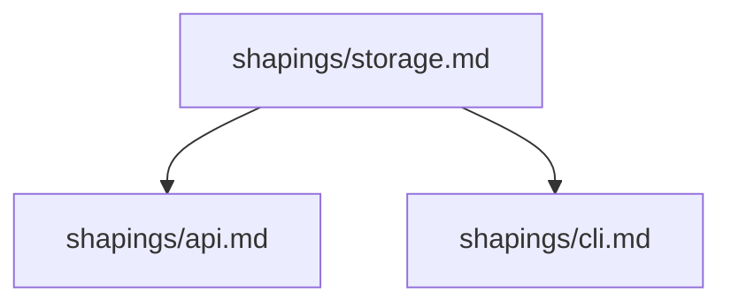

# project — The order of the questions

A project is a set of shapings and the order in which they get answered. It is
not another execution engine: it holds no gates, no commands and no evidence of
its own. `.riel/project.md` is optional — a single question needs only its
shaping and its run.

## Format

`riel-project/v1`: the title `# Project: <name>`, the marker
`<!-- riel-project/v1 -->`, then `## Objective` (one sentence: what the whole
project produces) and `## Graph` (the shapings and their dependencies).

A node is ONE shaping. Its label is the shaping's path (worktree-relative or a
bare filename), its uid or its slug:

    ## Graph
    - S1: .riel/shapings/storage.md
    - S2: .riel/shapings/api.md

The list register chains linearly. Use mermaid when tracks branch or run in
parallel:

Node ids are `S1`, `S2`, and so on. The questions are NOT copied here: they live
in each shaping's `## Question`, and `project status` reads them from there.

## What validation enforces

- every node resolves to a real file in `.riel/shapings/` that passes
  `shape validate` (one question, sourced findings);
- one shaping appears once — one shaping is one run and one PR;
- no cycles: a project orders work, it does not loop;
- every edge names a known node.

## Progress is derived, never written

A node is `done` when a contract bound to that shaping is done — that file's
own claims and gates, computed by the run engine. An active `.riel/runs/<slug>.md`
makes its shaping `active`. A node whose predecessors are not done is
`blocked`; the rest are `pending`.

`riel_project(verb="status")` returns the nodes, the dependency order, the next
shaping to run and the project's `done`. Delete a contract and its node
reopens: the progress was never a declaration.

## Executing a project

Several contracts may be active at once in one worktree, so independent tracks
can run in parallel; `run=<slug>` selects one on every verb:

1. `project status` names the next shaping in dependency order. Every node whose
   predecessors are done is `pending`, and every `pending` node is ready — so
   independent tracks start in parallel; `run=<slug>` picks one per verb.
2. Write `.riel/runs/<slug>.md` declaring that shaping under `### Shaping`.
   The contract is matched to its node by that binding, not by filename.
3. `run validate`, `run activate`, work the phase DAG, record gates with `note`.
4. The contract stays in `.riel/runs/`; when its evidence makes it done, the
   node is done. Nothing is moved and nothing is pruned.
5. Repeat until every node is done. One shaping is still one PR: parallel tracks
   share a worktree, not a deliverable.

Contracts are never pruned: they are the project's proof, and deleting one
would silently reopen a finished track.

## Authoring outside Riel

Riel explains this format and validates it; it never writes the file.
`riel_project(verb="new")` prints the skeleton — a project system, an MCP
server, an API or a copy-paste writes the bytes, then `project validate`
decides whether the graph is well formed.
