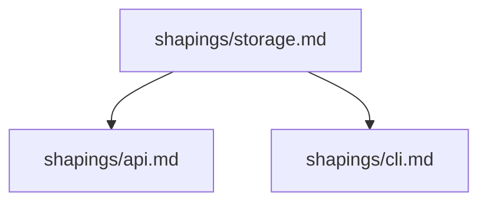

# Spec 9 — The project format (`riel-project/v1`)

A project is an ORDERING of shapings. It is optional: one question needs only
its shaping and its run. The project holds no gates, no commands and no evidence
of its own, and it never writes state.

## Role and location

`.riel/project.md` in the worktree's gitignored `.riel/`. Each node is one
shaping from `.riel/shapings/`; each shaping runs once and delivers one PR.
Parallel tracks execute in separate worktrees, because one worktree holds one
active run.

## File anatomy

    # Project: <name>
    <!-- riel-project/v1 -->

    ## Objective
    ## Graph

The marker is a standalone line before the first `## ` heading. `## Objective`
is one sentence: what the whole project produces. `## Graph` carries the
shapings and their dependencies, in either register:

    - S1: .riel/shapings/storage.md
    - S2: .riel/shapings/api.md

or a mermaid flowchart whose node labels are shaping references:

Node ids are `S1`, `S2`, … A label is the shaping's path (worktree-relative or
a bare filename), its uid (`shp_xxxxxxxx`) or its slug. The list register chains nodes
linearly in authored order; mermaid expresses branches and parallel tracks.

Questions are never copied into the project: they live in each shaping's
`## Question`, and status reads them from there.

## Validation

`project validate` refuses:

- a missing marker, a title that is not `# Project: <name>`, an empty Objective;
- no graph, or a node id outside `S#`;
- a node whose reference resolves to no shaping in `.riel/shapings/`;
- a referenced shaping that fails `shape validate` (its issues are reported
  against the node);
- the same shaping bound by two nodes — one shaping is one run and one PR;
- an edge naming an unknown node;
- a cycle: a project orders work, it does not loop.

## Derivation (status, next, done)

Progress is computed from the runs' own evidence, never declared:

- a node is `done` when `.riel/runs/<slug>.md` exists and that run's `done` is
  true — its claims covered and its gates passed, computed by the run engine;
- a node is `active` when the live `.riel/run.md` binds that shaping;
- a node is `blocked` when any predecessor is not done;
- otherwise it is `pending`.

`order` is the dependency order (Kahn, authored order breaking ties). `next` is
the first `pending` node in that order. The project's `done` is true when every
node is done. Each node reports its shaping path, uid, slug, question, status,
the run file that proves it and that run's revision.

Deleting an archived run reopens its node: the proof was the file, not a
checkpoint. Archived runs are never pruned.

## Verbs

- `project new` — render the template to STDOUT with `--param k=v`; writes
  nothing. An editor or a project system is the writing path.
- `project validate [FILE]` — the structural rules above (default
  `.riel/project.md`).
- `project status [FILE]` — the derived JSON. An invalid project reports its
  issues and exits 1 rather than inventing progress.

## Relationship to the other artifacts

    project.md   orders the shapings
    shapings/    one question each, with sourced findings
    run.md       executes ONE shaping, records typed evidence
    runs/        the archived proof a project derives its progress from

`run archive` is the transition from the third to the fourth. `clean` removes
all of them (archiving opt-in), which resets the project too.
